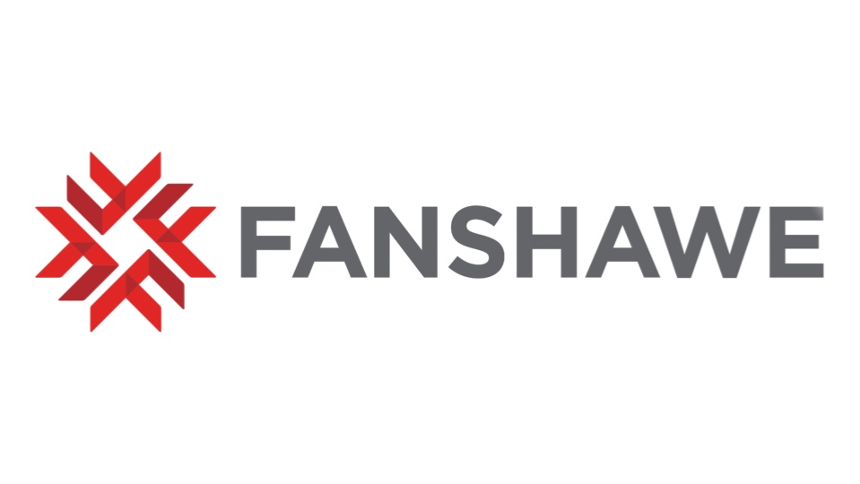

# IDP Industry Night Site 2026 ✨

Welcome to Industry Night 2026 🎉 Celebrate the creativity, innovation, and technical skills of Interactive Media Design students.

## **Table of Contents**
- [About](#about)
- [Skills](#skills)
- [Features](#features)
- [Installation](#installation)
- [Contact](#contact)

<h2 id="about">About 🧩</h2>
Industry Night 2026 is a digital showcase of student projects that highlights the creativity, technical skills, and collaboration of Interactive Media Design students. Explore unique projects and connect with the talented graphic designers, motion designers, front-end and back-end developers, and project managers who help these ideas come alive.

<h2 id="skills">Skills 💡</h2>
Here’s a snapshot of the skills and tools featured across this projects:

**Languages 💻**  
HTML5, CSS3, JavaScript

**Frameworks and Libraries 🛠️**  
Sass, Greensock

**Tools 🧰**  
Git, Figma, Adobe Illustrator, Adobe Photoshop, Adobe After Effects 

<h2 id="features">Features 🌟</h2>

📌 Portfolio Showcase

📌 Responsive across all devices 

📌 Accessible & User-Friendly 

<h2 id="installation">Installation ⚙️</h2>
To run the site locally:

- Clone this repository
- Navigate into the project directory
- Open the index.html file in your browser, or if using a local server, start the server and navigate to localhost to view.

<h2 id="contact">Contact Us ✉️</h2>
If you have any questions or want to collaborate, feel free to reach out anytime!

- [**Ben Kettlewell**](https://www.linkedin.com/in/ben-kettlewell-310736336?utm_source=share&utm_campaign=share_via&utm_content=profile&utm_medium=ios_app) – Motion Designer
- [**Juliana Gambuzza**](https://www.linkedin.com/in/juliana-gambuzza-bernal-4195452b9?utm_source=share&utm_campaign=share_via&utm_content=profile&utm_medium=ios_app) – Graphic Designer
- [**Hansini Chetan Dhameliya [Harlowe]**](https://www.linkedin.com/in/harlowe-hansini-d-dhameliya-a01282265/) –  Project Manager and Front-end Developer 
- [**Chanya Chumdee**](https://www.linkedin.com/in/chanya-chumdee-255b0634a) – Front-end Developer
